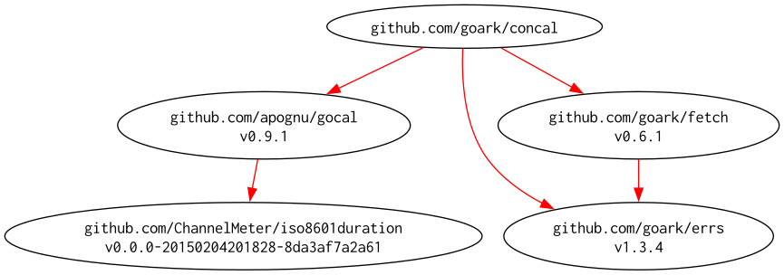

# concal -- Concurrent iCalendar parser wrapper for Go.

[](https://github.com/goark/concal/actions)
[](https://github.com/goark/concal/actions)
[](https://raw.githubusercontent.com/goark/concal/main/LICENSE)
[](https://github.com/goark/concal/releases/latest)
[](https://pkg.go.dev/github.com/goark/concal)

`concal` is a Go package for reading iCalendar (`.ics`) data from local files or HTTP URLs and parsing its events. It wraps [apognu/gocal](https://github.com/apognu/gocal) and also provides an API for parsing multiple sources concurrently.

## Requirements

- Go 1.26 or later

## Installation

```sh
go get github.com/goark/concal
```

## Parse One Source

`ParseOne` reads a local file or an HTTP URL and returns the events in the configured time period.

```go
package main

import (
	"context"
	"fmt"
	"time"

	"github.com/goark/concal"
)

func main() {
	parser := concal.NewParser(
		concal.WithStartTime(time.Date(2026, time.January, 1, 0, 0, 0, 0, time.UTC)),
		concal.WithEndTime(time.Date(2026, time.December, 31, 23, 59, 59, 0, time.UTC)),
	)

	events, err := parser.ParseOne(context.Background(), "./calendar.ics")
	if err != nil {
		panic(err)
	}
	for _, event := range events {
		fmt.Println(event.Summary)
	}
}
```

Pass an `http://` or `https://` URL instead of a file path to read a remote calendar.

## Parse Multiple Sources Concurrently

`Conc.Submit` starts parsing each source in its own goroutine. Consume events while `Wait` is running: `Wait` waits for parsing and event sends to finish, then closes the event channel. Calling `Wait` before receiving events can block because the event channel is unbuffered.

```go
package main

import (
	"context"
	"fmt"
	"log"

	"github.com/goark/concal"
)

func main() {
	parser := concal.NewParser()
	conc := concal.NewConcurrent(context.Background(), parser)

	for _, source := range []string{
		"./calendar-a.ics",
		"https://example.com/calendar.ics",
	} {
		if err := conc.Submit(source); err != nil {
			log.Printf("submit %q: %v", source, err)
		}
	}

	go conc.Wait() // start waiting in a separate goroutine
	for event := range conc.Events() {
		fmt.Println(event.Summary)
	}

	if err := conc.Close(); err != nil {
		log.Printf("parse calendars: %v", err)
	}
}
```

`Close` cancels outstanding requests and waits for parsing to stop. After normal event consumption, use it to retrieve errors accumulated while parsing. Sources cannot be submitted after `Wait` or `Close` has started.

## Parser Options

- `WithStartTime(t)` sets the beginning of the event range.
- `WithEndTime(t)` sets the end of the event range.
- `WithLocation(name, location)` adds a named time location for parsing events.
- `WithHTTP11Client(true)` forces HTTP/1.1 for URL requests.

If neither range endpoint is set, the default range is 90 days from the current time. If only one endpoint is set, the other endpoint is inferred as a 90-day range. If both are set in reverse order, they are swapped.

`ParseOne` returns errors for the individual source. `Parser.GetError` returns errors accumulated by that parser. `Conc.Close` returns errors accumulated while processing submitted sources.

## Modules Requirement Graph

[](./dependency.png)
